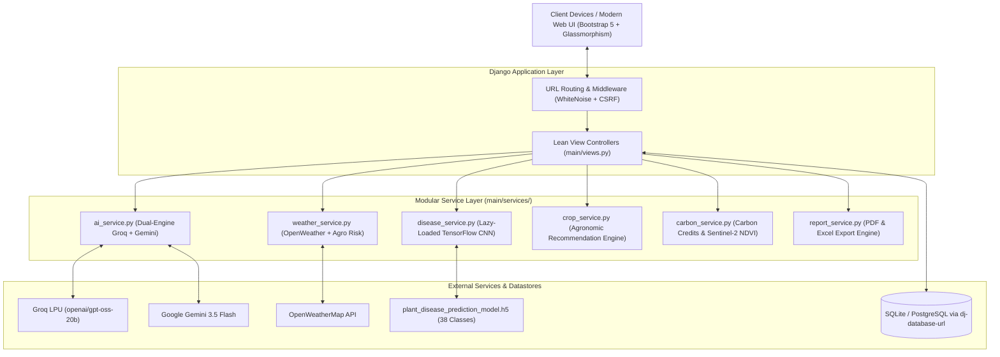

<div align="center">

# 🌾 KissanConnect — AI-Powered Smart Agritech Platform

[](https://www.djangoproject.com/)
[](https://www.python.org/)
[](https://www.tensorflow.org/)
[](https://groq.com/)
[](https://ai.google.dev/)
[]()

**An enterprise-grade, full-stack agricultural intelligence ecosystem bridging the gap between smallholder farmers, agronomic science, and sustainable digital commerce.**

[Live Demo](#-quick-start--local-setup) • [Architecture](#-system-architecture) • [Features](#-core-platform-modules) • [API Documentation](#-rest-api-documentation) • [Deployment](#-cloud-deployment-guide)

</div>

---

## 📌 Executive Summary & Problem Statement

Over 40% of the developing world's workforce depends on agriculture, yet smallholder farmers lose up to **30–40% of crop yields annually** to delayed pathogen detection, erratic climate events, and unfair supply chain middlemen.

**KissanConnect** is an integrated full-stack agricultural platform designed to solve these systemic pain points through:
1. **Deep Learning Vision**: Instant on-device/cloud plant leaf diagnosis across 38 crop disease classes.
2. **Dual-Engine GenAI Advisory**: Real-time conversational agronomy powered by Groq LPU speed with Google Gemini 3.5 Flash resilience.
3. **Zero-Middleman Marketplace**: Direct peer-to-peer farmer-to-consumer digital marketplace.
4. **Soil Carbon Monetization**: Regenerative agriculture tracking with Sentinel-2 satellite NDVI index simulation.

---

## 🏛️ System Architecture

KissanConnect is built using a decoupled **Service-Oriented Architecture (SOA)** on top of Django, ensuring clean separation of concerns, high maintainability, and zero-latency startup.



---

## 🚀 Core Platform Modules

### 1. 🦠 Computer Vision Plant Doctor
- **Model Architecture**: Deep Convolutional Neural Network (CNN) trained on the PlantVillage dataset across **38 plant disease classes** (Apple, Corn, Grape, Potato, Tomato, Pepper, etc.).
- **Inference Optimization**: Uses lazy-loading singletons to prevent startup bottlenecks, image normalization (224×224 RGB), and confidence distribution scoring.
- **Automated GenAI Remediation**: Every detected pathology triggers a multi-stage organic remedy, chemical fungicide/bactericide plan, and cultural hygiene protocol.

### 2. 🤖 ChatGPT-Style Full-Page Agricultural AI Assistant ("Kissan Sahayak")
- **Dedicated Full-Page Interface (`/chat/`)**: Inspired by modern LLM interfaces (ChatGPT/Claude/Perplexity) with clean conversation history, prompt starter templates, and distraction-free workspace.
- **Multi-Modal Diagnostic Chat**: Farmers can attach a leaf photo directly into the prompt bar. The system simultaneously performs CNN vision disease inference and weaves the diagnostic findings into the conversational treatment plan.
- **Text-to-Speech (Audio Voice Readout)**: Native Web Speech API integration allows farmers to click the 🔊 icon on any advisory to have it read aloud in natural speech.
- **Voice Input (Speech-to-Text)**: One-click microphone button for voice queries in English and Indian languages.
- **Primary Engine**: High-throughput **Groq LPU** (`openai/gpt-oss-20b` / `qwen3.8-27b`) delivering sub-second response times with zero token cost overhead.
- **Secondary Failover**: **Google Gemini 3.5 Flash** with low-token guardrails to conserve free-tier quotas.

### 3. 🌾 Intelligent Crop Recommendation Engine
- Analyzes soil characteristics (pH, N-P-K), farm size, agro-climatic zones, and ambient weather.
- Generates structured recommendations with suitability scores, expected yield per acre, harvest horizons, and net profit margins.

### 4. 🌤️ Weather Intelligence & Calamity Alerts
- Real-time weather monitoring via OpenWeatherMap API with automatic reverse-geocoding.
- Algorithmic agricultural risk detection: frostbite warnings, extreme heat stress, fungal outbreak risks, and heavy rainfall drainage advisories.

### 5. 🛒 Direct-to-Consumer Agri-Marketplace
- Eliminates intermediaries by connecting farmers directly with urban consumers and bulk buyers.
- Categorized listings (Fresh Produce, Certified Seeds, Organic Bio-Fertilizers, Equipment), inventory tracking, and checkout workflows.

### 6. 🌍 Soil Carbon Credit & Regenerative Farming Engine
- Calculates soil carbon sequestration potential (tCO₂e/hectare/year) based on regenerative practices (zero tillage, cover cropping, vermicomposting).
- Simulates **Sentinel-2 multispectral satellite monitoring** (NDVI, NDRE, NDWI moisture indices).
- Full audit and monetization pipeline for verified carbon offset sales to corporate buyers.

### 7. 📄 Instant Advisory Report Generation
- Dynamic on-the-fly **PDF generation** via ReportLab and **Excel workbooks** via XlsxWriter for agronomists, banks, and crop insurance audits.

---

## 🛠️ Tech Stack & Engineering Standards

| Layer | Technologies |
| :--- | :--- |
| **Backend Framework** | Django 5.1, Python 3.11+ |
| **Service Layer** | Clean Architecture / Service-Oriented (Decoupled controllers) |
| **Deep Learning** | TensorFlow 2.16, Keras, Pillow, NumPy |
| **Generative AI** | Groq API (`openai/gpt-oss-20b`), Google Gemini API (`gemini-3.5-flash`) |
| **Frontend** | HTML5, CSS3, JavaScript (ES6+), Bootstrap 5, FontAwesome 6, AOS Animations |
| **Static & Media** | WhiteNoise with Compressed Manifest Storage |
| **Reporting** | ReportLab (Vector PDF), XlsxWriter (Workbooks) |
| **Deployment** | Gunicorn, Docker, Procfile, Render / Railway ready |

---

## ⚡ Quick Start & Local Setup

### 1. Clone the Repository
```bash
git clone https://github.com/Venkatdanush/Kissan_Connect.git
cd Kissan_Connect
```

### 2. Set Up Virtual Environment
```bash
python -m venv venv
# On Windows:
venv\Scripts\activate
# On Linux/macOS:
source venv/bin/activate
```

### 3. Install Dependencies
```bash
pip install -r requirements.txt
```

### 4. Environment Configuration
Create a `.env` file in the project root (or copy `.env.example`):
```ini
DEBUG=True
SECRET_KEY=your-secure-secret-key
ALLOWED_HOSTS=localhost,127.0.0.1,*

# Primary AI (Groq)
GROQ_API_KEY=your-groq-api-key
GROQ_MODEL=openai/gpt-oss-20b

# Secondary AI (Gemini)
GEMINI_API_KEY=your-gemini-api-key
GEMINI_MODEL=gemini-3.5-flash

# Weather API
OPENWEATHER_API_KEY=your-openweather-api-key
```

### 5. Apply Migrations & Seed Sample Data
```bash
python manage.py makemigrations
python manage.py migrate

# One-click demo data population (Farmers, Marketplace Products, Orders, Carbon Credits):
python manage.py seed_demo_data
```

### 6. Run the Development Server
```bash
python manage.py runserver
```
Visit **`http://127.0.0.1:8000/`** in your browser.

---

## 📡 REST API Documentation

| Endpoint | Method | Description | Payload / Query |
| :--- | :---: | :--- | :--- |
| `/chat/` | `GET` | Dedicated ChatGPT-style AI Agronomist interface | N/A |
| `/api/ai-chat-advanced/` | `POST` | Multi-modal conversational chat + leaf photo diagnosis | `message`, optional `image` file |
| `/api/ai-chatbot/` | `POST` | Query Kissan Sahayak AI Assistant | `{"message": "string"}` |
| `/disease-detection/` | `POST` | Upload leaf image for disease diagnosis | Multipart: `plant_image` |
| `/api/crop-recommendation/` | `POST` | Get dynamic crop suggestions | `location`, `latitude`, `longitude` |
| `/api/reverse-geocode/` | `GET` | Resolve GPS coordinates to address | `?lat=17.38&lon=78.48` |
| `/api/add-product/` | `POST` | Publish new marketplace listing | `name`, `price`, `quantity`, `seller_name` |
| `/api/place-order/` | `POST` | Submit customer purchase order | `product_id`, `quantity`, `buyer_name` |
| `/api/get-satellite-data/` | `GET` | Get Sentinel-2 NDVI telemetry | `?latitude=19.99&longitude=73.78` |
| `/download-report/` | `GET` | Export agronomic analysis report | `?format=pdf` or `?format=excel` |

---

## ☁️ Cloud Deployment Guide

### Deploying to Render
1. Push your repository to GitHub.
2. Link your repository on [Render](https://render.com/).
3. Render will automatically detect `render.yaml` and configure the build & start commands:
   - **Build Command**: `pip install -r requirements.txt && python manage.py collectstatic --noinput && python manage.py migrate && python manage.py seed_demo_data`
   - **Start Command**: `gunicorn kissanconnect.wsgi:application --bind 0.0.0.0:$PORT --workers 2 --threads 4 --timeout 120`
4. Set your environment variables in the Render Dashboard (`GROQ_API_KEY`, `GEMINI_API_KEY`, `OPENWEATHER_API_KEY`).

### Deploying via Docker
```bash
docker build -t kissanconnect .
docker run -p 8000:8000 --env-file .env kissanconnect
```

---

## 👨‍💻 Author & Contributions

- **Lead Developer**: Built with passion for technology-driven social impact in Indian agriculture.
- **License**: MIT License. Open for academic research and community enhancement.
